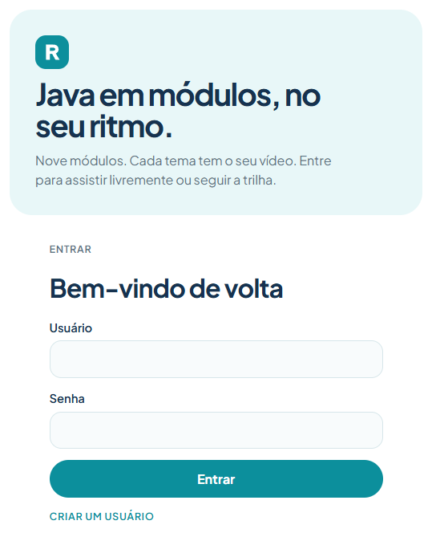
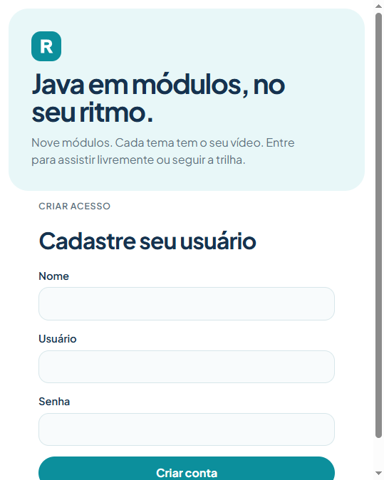
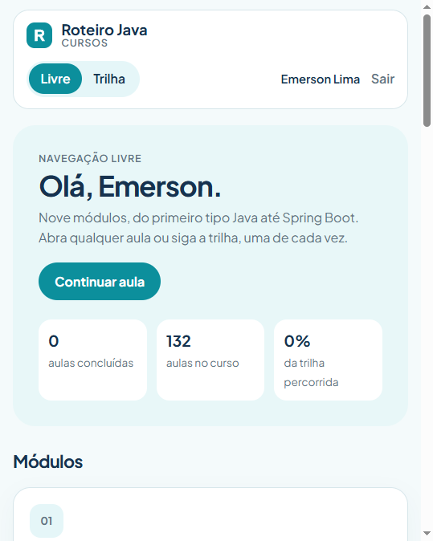
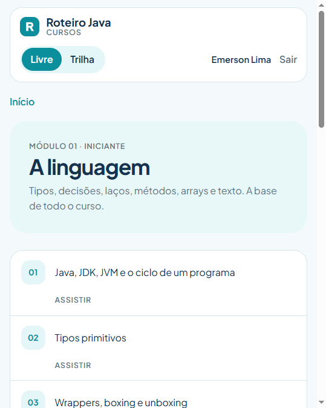
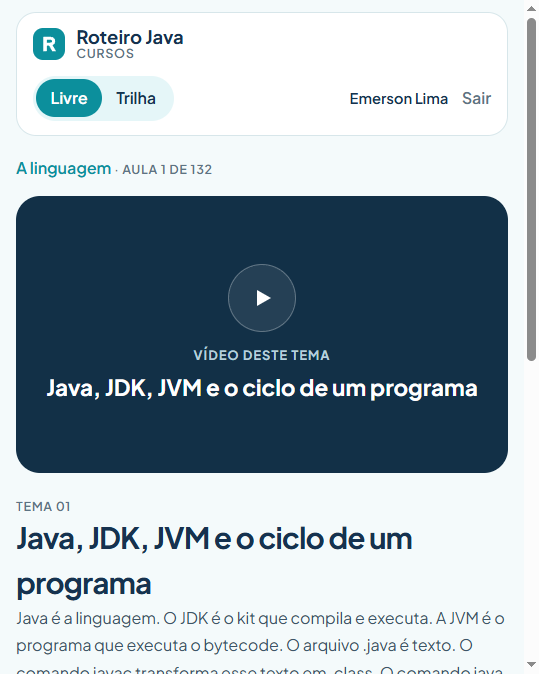
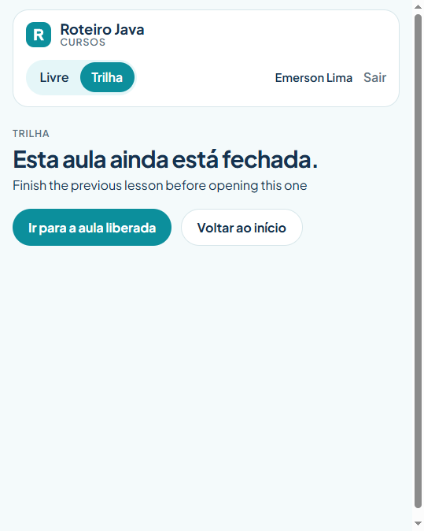

# Roteiro Java

Curso de Java no navegador: nove módulos, 132 aulas e dois jeitos de avançar. No modo **Livre**, qualquer aula abre. No modo **Trilha**, a aula só abre depois que a anterior foi marcada como concluída.

**Desenvolvedor:** Emerson Lima

O projeto reúne três serviços. O site é Next.js 15 com React 19. A API é Spring Boot 3.4 com Java 21. O banco é PostgreSQL 16. O jeito de subir os três juntos é o Docker Compose, na raiz deste repositório.

## Vitrine

### Entrar

Quem já tem conta informa usuário e senha. A sessão fica no navegador.



### Criar um usuário

O cadastro pede nome, usuário e senha de pelo menos 8 caracteres. A conta entra direto na home, no modo Livre.



### Início

O painel cumprimenta a pessoa, mostra o progresso e lista os nove módulos. **Continuar aula** abre a próxima da trilha.



### Módulo

Cada módulo mostra a etapa, o resumo e as aulas. Em Livre, todas podem ser assistidas. Em Trilha, as que ainda não abriram ficam fechadas.



### Aula

A aula traz o player, o resumo e o botão de concluir. Um link do YouTube vira o player incorporado. Qualquer outro endereço `https` vira a tag de vídeo. Sem endereço, ou com um endereço que não seja um vídeo válido, aparece o tema reservado.



### Trilha fechada

Na Trilha, abrir uma aula adiantada mostra o aviso e o caminho de volta para a aula que ainda pode ser vista.



## O que a máquina precisa

- [Docker](https://docs.docker.com/get-docker/) com o plugin Compose. No Windows, o Docker Desktop já traz os dois.
- Internet na primeira subida. O Compose baixa as imagens. Durante o build, a API baixa as dependências do Maven e o site baixa os pacotes npm.

Java, Node e PostgreSQL instalados na máquina não são necessários. Cada serviço sobe dentro do próprio contêiner.

## Subir

1. Abra um terminal na pasta que contém o `docker-compose.yml`.
2. Confira o Compose:

   ```bash
   docker compose version
   ```

3. Construa as imagens e suba os três serviços:

   ```bash
   docker compose up --build
   ```

   Deixe esse terminal aberto. A primeira vez leva vários minutos: a imagem da API roda `mvn verify` e a do site instala as dependências. Nas próximas, o build reaproveita o que não mudou.

4. Espere o Postgres ficar saudável, a API passar a responder na porta 8080 e só então o site iniciar. O frontend espera a API de propósito. Para ver o estado em outro terminal:

   ```bash
   docker compose ps
   ```

   Os três serviços precisam aparecer em execução. O Postgres e a API também precisam estar saudáveis.

5. No navegador **dessa mesma máquina**, abra http://localhost:3000. As portas estão publicadas só em `127.0.0.1`, então outro computador da rede não alcança o site.

6. O banco nasce vazio de usuários. Em **Criar um usuário**, cadastre nome, usuário e senha de pelo menos 8 caracteres. O usuário aceita letras, dígitos, ponto, `_` e `-`, e é gravado em minúsculas. A conta entra direto na home.

7. Confira a saúde da API em http://localhost:8080/api/health. A resposta esperada é `{"status":"ok"}`.

## Endereços

| Serviço | Endereço |
| --- | --- |
| Site | http://localhost:3000 |
| Entrar | http://localhost:3000/entrar |
| Cadastro | http://localhost:3000/cadastro |
| API | http://localhost:8080 |
| Saúde da API | http://localhost:8080/api/health |
| Banco, a partir da máquina | `localhost:5433`, banco `cursos`, usuário `cursos`, senha `cursos` |

## Como navegar

No topo, **Livre** e **Trilha** gravam o modo da conta e recarregam a página. **Sair** apaga a sessão local.

- **Livre:** qualquer aula abre.
- **Trilha:** a primeira aula abre sempre. A seguinte só abre quando a anterior foi marcada como concluída. Concluir de novo uma aula já concluída não duplica o progresso.

Os módulos e as aulas sobem pelo Flyway, em `course-api/src/main/resources/db/migration`. Usuários e aulas concluídas ficam no volume `pgdata`.

## Vídeos

O endereço de cada aula fica na coluna `video_url` da tabela `lesson`. A migração `course-api/src/main/resources/db/migration/V5__video_aula_1.sql` deixa o formato genérico na primeira aula:

```sql
UPDATE lesson
SET video_url = 'https://www.youtube.com/watch?v=SEU_ID'
WHERE global_order = 1;
```

Troque `SEU_ID` pelo identificador do vídeo antes de aplicar essa migração num ambiente novo. `global_order` é a ordem da aula no curso, de 1 a 132. O endereço tem no máximo 500 caracteres.

## Parar

No terminal do Compose, `Ctrl+C` interrompe os serviços. Para derrubar os contêineres:

```bash
docker compose down
```

Subir de novo com `docker compose up --build` reaproveita usuários e progresso. `docker compose down -v` apaga o volume. O próximo sobe pede um usuário novo. Os módulos e as aulas voltam pelo Flyway.

Para subir cada aplicativo fora do Compose, veja `frontend/README.md` e `course-api/README.md`.

## Licença

Este projeto está sob a licença Apache 2.0. O texto completo está em [LICENSE](LICENSE).

Copyright (c) 2026 Emerson Lima
